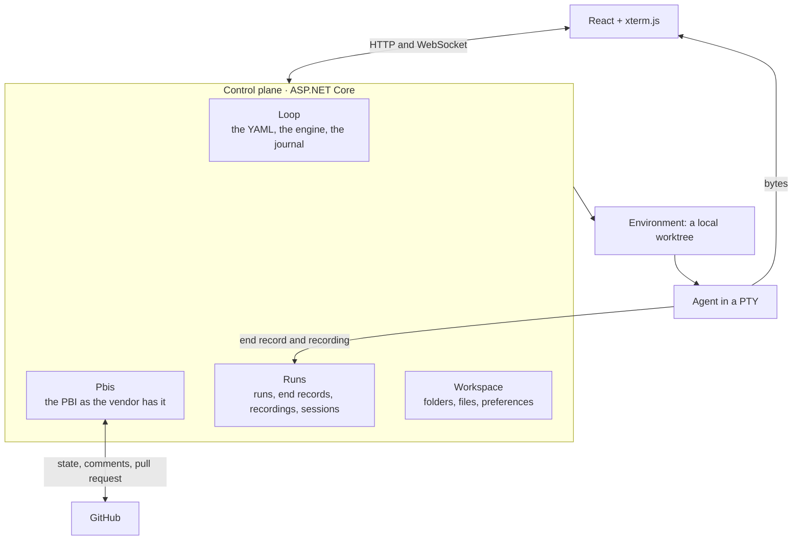

# Architecture

A map of the code and the reasons for its shape. The requirements are in
[`openspec/specs/`](openspec/specs/); the words are defined in [README.md](README.md#the-concepts).

## The control plane

One process with five **ports** to the outside, an adapter behind each. The interface is its client
over HTTP and a WebSocket, so nothing it shows depends on being on the same machine. The loop knows
nothing of worktrees or of where the agent runs. The PBI stays and runs are ephemeral: a finished
run's session is gone, and its outcome, the state it led to and its recording remain.



```
src/
├── shared/    # BuildingBlocks (ports, contracts, CQS), ServiceDefaults, Infrastructure (adapters), analyzers
├── modules/   # Pbis, Loop, Runs, Workspace
├── root/      # Server (API, PTY WebSocket, engine schedule, SPA), MigrationService, AppHost and the gate
├── frontend/  # Vite + React SPA
└── tests/     # Architecture, Infrastructure (each adapter against the real tool), Functional, Server, EndToEnd
```

Every test project runs in [the gate](AGENTS.md#the-gate).

## The five ports

[`BuildingBlocks/Ports/`](src/shared/AiOrchestrator.BuildingBlocks/Ports/) holds them. Modules
depend on these interfaces and never on an adapter, which is why a module cannot spawn a process even
by accident. [`AddPorts()`](src/shared/AiOrchestrator.Infrastructure/Ports.cs) composes the adapters,
each port's in its own folder of `Infrastructure`. `PortTests` keeps the count at five; a sixth is a
finding for the issue, not a quiet addition to a diff.

| Port | What it does | Adapter today |
| --- | --- | --- |
| `IPbiProvider` | Lists and reads PBIs, moves the state, sets the hold, comments and edits a comment, opens, marks and reviews the pull request, closes the issue, and reads a repository's history of PBIs and pull requests for Metrics (#734). Every write answers what it read back. | GitHub, through `gh` |
| `IAgentProvider` | Launches a CLI with its command and model, reads its end and cost, and says from its silent screen whether it waits for a permission or a login (#706) | Claude Code |
| `IEnvironment` | Prepares where a run runs, says how a launch starts inside it, and retires it | `worktree`: a worktree by `.aio/steps/prepare`, removed by `cleanup`; the launch unchanged. `sbx`: that worktree's branch in a Docker sandbox per PBI, cloned with `sbx create --clone`, the launch wrapped in `sbx exec -it` (#614) |
| `ISession` | The run's terminal: start, write, read, resize, kill, record | A PTY (Porta.Pty), recorded in asciicast v2 |
| `IScriptRunner` | Runs a script of `.aio/` or `.aio/steps/` and reads its last line as JSON | Local |

Only the GitHub adapter knows that the vendor is `gh` and a state is a `status:*` label;
`VendorTests` fails the build when a module or a contract names either. A provider with no adapter
fails its run with `AgentNotFound`.

Three more folders of BuildingBlocks cross a boundary without being ports: **`Files/`**, what
Workspace asks of a checkout and of the machine (`ICheckoutProbe`, `IBranchFiles`, `IDesktopIntegration`,
`IBranchPublisher`, which installs the harness on a branch of origin, `IEvidenceBranch`, which copies
a run's recording to `aio/evidence`, and `IMachineProbe`, the CLIs
no adapter drives and how each is installed here, for the requirements screen), registered by
`AddFiles()` because they need git and the login shell); **`Folders/`**, `IFolderDirectory` and the
values `LocalPath`, `RepositoryIdentity` and `SelfCheckout`; and **`RunRequests/`**, `IRunRequests`,
how Loop asks Runs to start a run or a script without either referencing the other, and `IRunEndings`,
how Runs tells Loop that a run ended so the journey comment lists it (#697).

## Backend

A modular monolith. The host discovers `AiOrchestrator.Modules.*.dll` at startup
([ModuleRegistration](src/shared/AiOrchestrator.BuildingBlocks/Modules/ModuleRegistration.cs)), so a
module needs a solution entry and a project reference, not a host edit. Each module owns its tables
in the checkout's SQLite database (ADR-0003), its migrations and its feature slices; Pbis stores
nothing. The Server never migrates in development: the MigrationService migrates every module, seeds
the first folder and exits, and the Server waits on it. Installed, the Server migrates itself.

A use case is **one file**: route, request, response, command, validator and handler, nested and
`internal`. Requests travel `Logging → Authorization → Validation → Handler`
([`AddVsaCqsArchitecture()`](src/shared/AiOrchestrator.BuildingBlocks/CQS/AddVsaCqsArchitecture.cs)).
Each declares what it requires with `[Requires]`, and **an undeclared request is refused**, so a use
case added without thought is locked rather than open. Authorization sits outside validation, so a
caller with no role learns nothing about the payload's shape.

**Identity is one person.** [`AddIdentity()`](src/shared/AiOrchestrator.ServiceDefaults/Identity/IdentityComposition.cs)
grants the owner everything and **refuses to start** off loopback, where it would grant it to anyone.

**One error body.** Handlers return `ErrorOr<T>`, mapped by
[`ApiResults.Problem`](src/shared/AiOrchestrator.BuildingBlocks/Api/ApiResults.cs); validation
failures short-circuit to the one
[`GlobalExceptionHandler`](src/shared/AiOrchestrator.BuildingBlocks/Api/GlobalExceptionHandler.cs).
Both are RFC 7807. A refusal a person can act on is a 4xx carrying the remedy, not a 500.

**Module boundaries.** Nothing crosses a module's tables: `PbiRun.FolderPath` is a path, not a
foreign key. Loop reaches Runs through `IRunRequests` and Workspace through `IFolderDirectory`. The
analyzers fail the build on a public CQS request, a cross-module reference, a public domain entity, a
controller, or an entity through an endpoint; ArchitectureTests catch what they structurally cannot.

**The engine** is a use case of Loop; the Server only schedules it. A pass reads every folder's
`.aio/loop.yaml`, lists its open PBIs at the vendor, asks the planner what each needs, and applies
the answer: a run, a script, a label, a hold. Every decision is a line of `loop_journal`. Passes run
one at a time, and a person's decision waits for the pass in progress. The schedule walks only the
folders whose engine is on, and reads its interval and the switches from `loop_settings` before every
wait; configuration gives what nobody changed. The stale threshold is Runs', in `runs_settings`, and so
is the agents' permission mode, read as each run starts (#578).

## Where a recording travels

A run's recording is written on the disk of the instance that ran it, and a copy goes to the
repository (#697), so another instance, the installed one or a second laptop, replays it with nothing
in its database. When a run ends, [`RecordingEvidence`](src/modules/Runs/AiOrchestrator.Modules.Runs/Features/PbiRuns/RecordingEvidence.cs)
pushes its `session.cast` to `aio/evidence` at the folder's `origin`, at `<pbi>/<run id>/session.cast`,
one commit each, and tells the loop through `IRunEndings`; the loop writes that path in the row of the
`aio:journey` comment. [`GitEvidenceBranch`](src/shared/AiOrchestrator.Infrastructure/Files/GitEvidenceBranch.cs)
builds the commits in a temporary worktree under the instance's runs directory, never in the folder's
checkout or a PBI's worktree. The branch is an orphan and only gains files at paths no other run
writes, so two instances pushing at once settle with a fetch and another try. A push that fails is a
warning in the log, never the run's failure, and the next run of the repository pushes what is
missing. The Journey of an instance without the run reads the file back through `IPbiProvider`
(`GET /api/pbi/recording`) and plays it with the same player. `claim`, `merge` and `cleanup` name
only `change/<n>`, so they leave it alone. It is a copy: nothing local is deleted or moved. Both the
push and the comment wait for the harness: a folder without `.aio/version`, such as a client's
repository opened only to look or to run a terminal, gets nothing pushed and no comment.

## Where runtime data lives

`.aio/` holds only what a person reads and edits: the loop, the gate, the commands' context, the
templates and the package's scripts. Nothing a run writes lands there (#757). The development
instance, started by the AppHost from a checkout, keeps its database, its runs and its scripts'
outputs in `src/artifacts/data/` of that checkout
([`AppHost.cs`](src/root/AiOrchestrator.AppHost/AppHost.cs)): inside it, so deleting a worktree
deletes its data and two checkouts never share a database (ADR-0003), and beside the coverage and test
results the gate already writes under `src/artifacts/`, which `artifacts/` already ignores. The
installed app keeps the same three in `~/.aiorchestrator/`. laya's Python environment, its pidfile
and its log are the machine's, in `~/.aiorchestrator/laya/<pin>/`, where `<pin>` is a hash of the
content of `.aio/scorers/laya/laya-requirements.txt`
([`laya`](.aio/scorers/laya/laya)), not of its path: 915 MB built once per machine and pin
instead of once per worktree, one pidfile for the one server its fixed port allows, and a pin edit
builds beside the old environment instead of over it.

What it weighs, measured on 13 October. The 30 runs of aio-dogfood#4's sub-issues (#5 to #9) in the
development app left 29 recordings, 4,171,795 bytes; committed one by one on an orphan branch, git
packs them into 358 KiB (a bundle of the branch is 361,352 bytes), because asciicast is text that
compresses well. A plain `git clone` of the repository brings the branch as `origin/aio/evidence`,
so every clone pays those kilobytes. `sbx create --clone` clones the folder's checkout, not GitHub, and
the checkout has the branch only as a remote-tracking ref, which a clone does not copy: a local
`git clone` of the checkout lists no `aio/evidence`, and with `--no-local` it holds none of its
objects (a plain local clone copies the object store as it is, so the packed bytes may ride along
unreferenced). The sandbox itself was not measured, since sbx here has no network policy and creating
one needs it. At 358 KiB for an epic of 30 runs the branch is far from 50 MB, so the sandbox's clone
stays as it is and does not need `--single-branch`, and nothing is compressed.

## Whose commit it is

On one machine the engine, its runs and the person commit with one git identity, so the author of a
commit tells nobody apart. The committer does (#741): [`AgentLaunch`](src/shared/AiOrchestrator.Infrastructure/AgentProviders/AgentLaunch.cs)
starts a run's agent with `GIT_COMMITTER_NAME=aio run <id>`, which `sbx exec -e` carries into a
sandbox, and [`LocalScriptRunner`](src/shared/AiOrchestrator.Infrastructure/Scripts/LocalScriptRunner.cs)
starts each script with `aio script <name>`, both at `noreply@aio.invalid`
([`CommitMark`](src/shared/AiOrchestrator.BuildingBlocks/Ports/CommitMark.cs)). The author is never
touched. The two paths that rewrite commits keep the mark: `rebasing` replays with
`git rebase -x scripts/keep-committer`, which gives each commit its committer back, and the squash
merge makes a new commit on the trunk while GitHub keeps the pull request's own, which are the ones
Metrics reads. A trailer, `Aio-Run: <id>` or `Aio-Script: <name>`, says the same for a path that
cannot keep the committer; Metrics reads both, and no path writes one today. A commit without a mark
is a person's, whichever instance worked the PBI; those older than the earliest marked commit are
nobody's, and the Metrics notes say so.

## What we did not invent

- **A run's recording is an asciicast v2**, written by `ISession` and played by `asciinema-player`.
- **A run ends with a command.** `aio done <outcome> [--reason …]` writes the end record, validated
  against [`.aio/schemas/done.v1.json`](.aio/schemas/done.v1.json). It is untrusted input:
  missing or invalid, the run fails with that cause, so a forgotten end does not leave a PBI hanging.
- **The agent's hooks** ([`.claude/hooks/pre-tool-use`](.claude/hooks/pre-tool-use)) take their shape
  from issue-orchestrator, like the idea that labels are the control plane's external API.
- **The Files tab** uses react-arborist and CodeMirror 6. Monaco stays out because it is an IDE.
- **The skeleton** (BuildingBlocks, the pipeline, module discovery, the migration split, the
  analyzers) comes from the sibling `ai-orchestrator` project, which paid for it.

## Frontend

A Vite + React SPA served same-origin by the host: no API base URL, no CORS. **The contract is
generated**: `dotnet build` writes [`openapi.json`](src/frontend/shared/http/openapi.json) and
`pnpm contracts` generates `contracts.ts`, so a DTO changed on the server is checked against the
frontend in the same gate. Server state is TanStack Query, with the calls in
[`queries.ts`](src/frontend/shared/http/queries.ts). A live terminal is a WebSocket at
`/api/sessions/{runId}/attach`, drawn with xterm.js. The first screen is budgeted at 200 kB gzip in
`vite.config.ts`, and each screen loads behind its own `lazy`. Styling is [DESIGN.md](DESIGN.md)'s.

## How it installs

One process: the Server with the frontend inside it, packed as the .NET tool `aio`
([`scripts/pack`](scripts/pack), ADR-0009), which
[`scripts/release`](scripts/release) pushes to nuget.org, reads back, and only
then tags. The package is framework-dependent: it carries the compiled app and needs the .NET 10
runtime on the machine, so the same package runs on macOS, Linux and Windows and nothing is signed.
`dnx aio` runs it from the NuGet cache without installing it; `dotnet tool install -g aio` keeps it
in the tools folder, and `dotnet tool update -g aio` replaces it. Started, it migrates its database in
`~/.aiorchestrator/`, listens on loopback on 48117 when free, and opens the default browser there
([`Installation.cs`](src/root/AiOrchestrator.Server/Installed/Installation.cs)); a second launch of
the same version only opens the browser, and one of another version asks the running one to stop
through `POST /api/app/stop`, loopback only and absent from a checkout, and takes the port
([`Takeover.cs`](src/root/AiOrchestrator.Server/Installed/Takeover.cs)). The window is the browser's:
the SPA is a PWA that Chrome and Edge install.
[`Updates.cs`](src/root/AiOrchestrator.Server/Installed/Updates.cs) reads nuget.org's flat container
(`/v3-flatcontainer/aio/index.json`, no credential) when it starts and when Settings asks, and
Settings shows the command for how this copy was started: the update command for an installed tool,
the next `dnx aio` for the other. For the installed tool, *Update and restart*
([`SelfUpdate.cs`](src/root/AiOrchestrator.Server/Installed/SelfUpdate.cs), ADR-0010) runs that
command and restarts into the new version. `aio service install`, or Settings' *Start at login*,
registers it to start at login as a LaunchAgent or a `systemd --user` unit
([`LoginService.cs`](src/root/AiOrchestrator.Server/Installed/LoginService.cs)), restarted when it
fails and never after a clean stop.
