# AI Orchestrator

A console that takes each PBI through a loop declared in YAML. Each step is done by an agent, a
script or a score, and when a score comes out high, the loop waits for a person.

It is the seat of the developer who supervises the loop: from there they settle what the loop could
not, see where it went wrong and correct it, so the console shows everything the loop did and why.
PBIs are GitHub issues, each step runs a CLI agent in a pseudo-terminal in a worktree, and code is
reviewed in the vendor's pull request. The control plane is one process and the interface its
client, so nothing on screen depends on being on the same machine as the worktree.

It is not an IDE (one tab reads and edits a file, nothing runs there), not a project manager (the
PBI and its history belong to the vendor), not a cloud agent platform, and not a panel of loose
sessions: a session exists because a step opened it or a person opened one on a folder or a PBI.

## Install

It is the .NET tool `aio` on nuget.org, and needs the [.NET 10](https://dotnet.microsoft.com/download)
runtime or SDK. To try it without installing anything:

```bash
dnx aio
```

To keep it, install it once and start it with `aio`. It opens the browser at
`http://localhost:48117/`, and keeps its data in `~/.aiorchestrator/`.

```bash
dotnet tool install -g aio
aio
```

To have it start when you log in, with no terminal, register it as a service of your session: a
LaunchAgent on macOS, a `systemd --user` unit on Linux. Settings' *Start at login* does the same.
Windows has no service yet.

```bash
aio service install     # and uninstall, or status
```

Settings says when there is a newer version, and *Update and restart* installs it and restarts into
it. By hand, or to remove it:

```bash
dotnet tool update -g aio
dotnet tool uninstall -g aio
```

A newer `aio` started while an older one runs asks the older one to stop and takes its place.

The rest of what it needs (git, the GitHub CLI, Node and an agent CLI) is on the requirements
screen, which opens on the first start and says what is missing and the command that installs it.

## The concepts

Five concepts are enough to use the product.

| Concept | What it is | Where the truth is |
| --- | --- | --- |
| **PBI** | The unit of work and of navigation: a GitHub issue, with its proposal and its pull request (one PBI, one change, one PR). | At the vendor |
| **Loop** | The YAML of states that says which way a PBI goes and what is done in each. One per repository. | `.aio/loop.yaml` |
| **Step** | What runs in a state: an agent with its command, a script, or a score. | In the loop |
| **Run** | One execution of a step on a PBI: who, when, cost, outcome and recording. A PBI's runs are the loop's diary of it. | In the control plane |
| **Hold** | The loop stopped because a person has to decide: a high score, a red gate, a failed run or the rounds used up. | The `status:holding` label |

The internal pieces are not managed or navigated to: a **Folder** is a local checkout where steps
may run; an **Environment** is where a run runs (`worktree` on this machine, or `sbx`, a Docker sandbox)
and hands back a pseudo-terminal; a **Session** is a live terminal, in the tray; an **Agent** is the CLI (`provider`)
and `model` of a step; a **Worktree** is a run's scratch directory on the branch `change/<n>`.

These words are used exactly, in code, in copy and in documents. A PBI is never a task or a ticket;
an agent is a CLI in a terminal, never a pod or a bot; a run is read inside its PBI's Journey, never
on a screen of its own.

## Principles

Eight rules settle any design question, here and in the product. Each comes from a real failure.

1. **The vendor is the truth.** A PBI's state is its label at the vendor. The console reads it and
   moves it, and never keeps a copy that counts as the answer.
2. **What a command can decide, a model does not.** The gate, the claim and the merge are scripts. A
   model proposes, reviews or scores, and its score only chooses the next state.
3. **Guardrails block and documents inform.** An important rule is checked in a script or a hook;
   writing it in a prompt is not enough.
4. **A write does not count until it is checked.** After labelling, merging or publishing, the
   console reads it back, and says so when it does not match.
5. **Nothing retries.** A failure stops the PBI, applies the hold and says why. The only loop allowed
   is the one the YAML declares, with its limit.
6. **Each screen answers one question.** If a screen has to explain where the PBI is, the answer is
   the PBI's screen, not another one.
7. **What the loop decides, a person can read.** A score without its reason, a hold without a cause
   or a run without an end record is not a fact.
8. **Between two choices, the simple one wins.** A complex option needed later adapts to the simple
   one, not the other way round.

## The loop

A YAML of states read top to bottom. Each state is a `status:*` label and runs one thing. This
repository's own is [`.aio/loop.yaml`](.aio/loop.yaml); [CONTRIBUTING.md](CONTRIBUTING.md)
says what happens in each state.

What in `.aio/` is the repository's and what is the package's, what each step of the package's
loop reads and answers, and how a repository makes the gate and `config.json`
its own is [`.aio/README.md`](.aio/README.md). The harness package installs that page in
every repository, and so is every file of `.aio/` that starts with the line `Managed by aio`: an update overwrites them and writes nothing else that is there.

```mermaid
flowchart LR
  ready["ready-for-proposal<br/>/aio:refine"] --> spec["spec-ready<br/>claim · /aio:propose"]
  spec --> proposal{{"proposal-review<br/>score: risk-score"}}
  proposal -- low --> progress["in-progress<br/>/aio:implement"]
  proposal -- high --> holdP(["hold"]) --> progress
  progress --> verifying["verifying<br/>gate · evidence · quality"]
  verifying -- red --> holdG(["hold"])
  verifying -- green --> review["code-review<br/>/aio:review-diff"]
  review -- "rejected · max 2" --> progress
  review -- approved --> mreview{{"merge-review<br/>score: diff-risk"}}
  mreview -- low --> retro["retro<br/>/aio:review"]
  mreview -- high --> holdR(["hold"]) --> retro
  retro --> merging["merging<br/>archive · merge"]
  merging -- merged --> done["done"]
  merging -- conflict --> rebasing["rebasing<br/>/rebase-safely · max 1"] --> merging
```



A person is needed at two points, and a score decides both; when both are low, a PBI goes from
refined to merged without waiting. Each state produces one outcome, which is why code review is two
states: the agent that reviews, and the score that decides whether a person is needed.

| Key | What it does |
| --- | --- |
| `agents` | Declares each role once: `provider` is the CLI (`claude-code`, `copilot`, `opencode` or `codex`), `model` is optional. A state can override either. |
| `agent` and `command` | Who does the step and what it is asked. The outcome comes from the run's end record, written by `aio done`. |
| `script` | A mechanical step, one or a list, found by name in `.aio/` and then `.aio/steps/`, run before the state's agent or score. Every script answers a last JSON line with `outcome` (an outcome of `on`), `wait: true` (not yet) and `why`; without either, exit 0 passes and anything else holds. |
| `score` | A script whose `outcome` is a model's opinion: `low` goes on alone, `high` asks a person. A state runs an agent or a score, not both. Before the first score of a pass the engine runs `.aio/scorers/laya/laya ensure`; when the model server still cannot start, the score answers `unknown`, which `on` may name, and otherwise holds the PBI saying it could not score. |
| `hold` | Inside an outcome of `on`: stops the PBI with the reason it carries. Released, the PBI goes to the hold's `next`; with no `next`, the person chooses. |
| `on` and `next` | `on` takes each outcome to a state; with one way out, `next` is enough. `on` does not nest. |
| `pr` | Beside a `next`, on the state or on an outcome of `on`: what the engine does to the pull request on that move. `draft` opens it as a draft, `ready` marks it ready for review, `close` closes the issue. |
| `max_loops` | Required on any state that can go back. Used up, the PBI is held. |
| `back` and `tab` | `back` is the state a person's *Request changes* sends the PBI to from this one; without it the button does not appear. `tab` is the PBI tab marked while the PBI is here: `journey`, `issue`, `proposal`, `review` or `files`. |
| `wip` | How many agent runs may be live at once. |

A state no entry declares (`done`, `needs-refinement`) is one where the loop does nothing. When a PBI
leaves a state, the engine does whatever touches the vendor, the same way for every state: it moves
the label, applies the hold, and does the `pr` the transition declares: in this repository's loop,
the draft pull request leaving `spec-ready`, ready leaving `verifying` green, and the issue closed
leaving `merging` merged. A command never does any of that. The exact rules are the capabilities under [`openspec/specs/`](openspec/specs/).

After the gate, `evidence` shows a reviewer the screens a change touched, in one comment on its issue,
as `evidence` in the repository's own [`.aio/config.json`](.aio/config.json) says. This repository
names `capture`, because its tests take the screenshots. Then `quality` publishes, in another comment, the
coverage of the lines the change added, the CRAP of the methods it touched, mutation, new duplicated
lines and tests lost, against the lines of `quality` in the same file; it
reports and blocks nothing, and the Review tab shows it between the gate and the captures.

## Quick start

To work on it from a checkout, not to use it. Requires the .NET 10 SDK, Node 22+ with pnpm, the [Aspire CLI](https://aka.ms/aspire/cli) and the
GitHub CLI signed in (`gh auth login`). No Docker: persistence is one SQLite file (ADR-0003).

```bash
aspire start --isolated --apphost src/root/AiOrchestrator.AppHost/AiOrchestrator.AppHost.csproj
```

The first boot seeds this checkout as the one folder, and the PBIs are its open issues, read through
`gh` with the credential it already holds. **The engine is off unless configured**, because a pass
claims PBIs, writes labels and starts agents that spend money. It is switched per folder from the
console (`PUT /api/loop/engine`), without a restart; `Loop__Enabled=true` starts every folder on. It
passes every `Loop__IntervalSeconds` (60 by default), which Settings changes, and
`POST /api/loop/run-once` runs one pass by hand.
[AGENTS.md](AGENTS.md) says how to work here and where everything else is.
